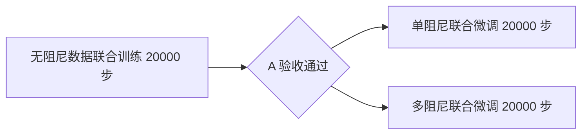
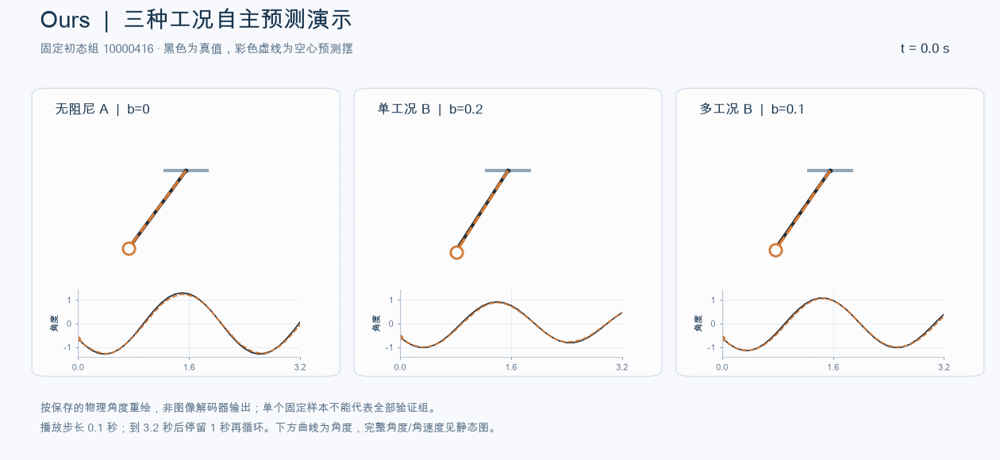

# WMtest：耗散视觉动力学实验

整理二维耗散模型与 **LeHami、LeWM、H-JEPA** 的训练代码、配置、验证结果及演示。保留官方核心代码的来源与许可证；原始实验文件按目录归档，新增文档提供阅读和运行入口。

## 从这里开始

- [结果索引与四方法对比](docs/RESULTS.md)：指标、报告、动图和适用范围。
- [运行与分阶段训练](docs/TRAINING.md)：安装、数据生成、H-JEPA A→B 流程。
- [文件范围与复现边界](docs/ARTIFACTS.md)：哪些文件入库，哪些需要另行取得。
- [第三方来源与许可](THIRD_PARTY_NOTICES.md)。

## 实验状态

已完成的四方法对比采用同一物理读出评测协议，包含无阻尼、单阻尼和多阻尼验证结果。它们是**单种子、不同模型适配版本**的实验结果，不能视为原论文的完整复现或严格等计算预算排名。

H-JEPA 后续诊断发现无阻尼表征偏静态、预测运动不足，且旧停止率漏检了“角度不动但读出角速度非零”的情况。阅读旧报告时应同时阅读[诊断说明](docs/RESULTS.md#h-jepa-诊断与重训)。

新的 H-JEPA 流程为：



三个阶段始终保留耗散项，各自进行4000／20000步验收。归档提交记录为 **48085／48086／48087**；这是 **2026-11-09 13:54左右（北京时间）的排队快照**，本次整理没有重新查询服务器或宣称重训完成。

## 目录

```text
experiments/
  damped_pendulum/
    dpbench/       模型、数据、训练和评测实现
    configs/       实验配置与训练协议
    scripts/       数据生成、训练、评测、Slurm 入口
    tests/         软件验证
    third_party/   带来源校验的官方核心代码
    reports/       指标、轨迹、图表、动图和诊断
    studies/       分阶段计划、历史代码快照和运行证据
    output/pdf/    已生成的技术报告
  lehami_official_reproduction/
    scripts/       官方 LeHami 单种子复现脚本
    upstream/      固定版本的相关源码
    reports/       复现对比结果
docs/              导航、运行说明、快照清单
tools/             整理及快照校验工具
```

`studies/` 包含历史配方及当时的源码副本，用于追溯实验；最新 H-JEPA 配方是 `hjepa_staged_retrain_20261109T025341Z`，不是较早的 scratch 配方。历史文档中的“当前状态”仅指其记录时刻。

## 快速检查

```bash
python3 tools/verify_snapshot.py
cd experiments/damped_pendulum
python3 -m venv .venv
source .venv/bin/activate
pip install -r requirements.txt
python -m pytest tests/test_hjepa_retrain.py tests/test_hjepa_acceptance.py tests/test_comparison_training.py -q
```

CUDA 服务器应按环境安装匹配的 PyTorch 2.8.0 构建。数据集、权重和原环境均未放入 Git；默认预检命令不启动训练。详见[运行说明](docs/TRAINING.md)。

## 演示

同一初态下，无阻尼、单阻尼、多阻尼模型的示例；完整指标与四方法演示见[结果索引](docs/RESULTS.md)。


