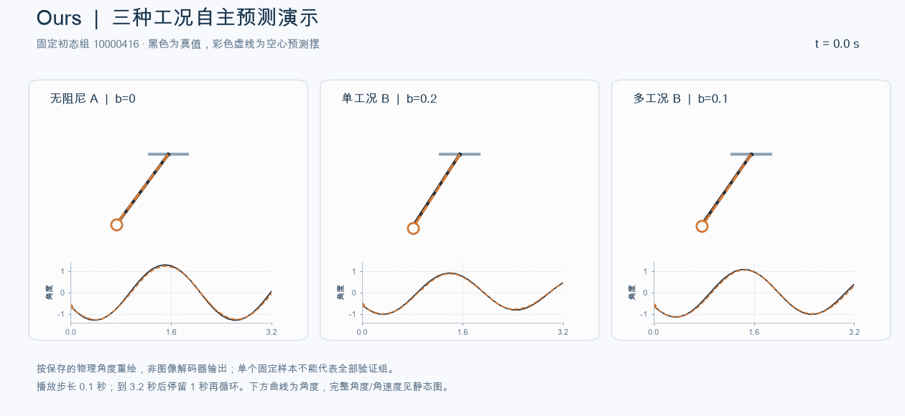
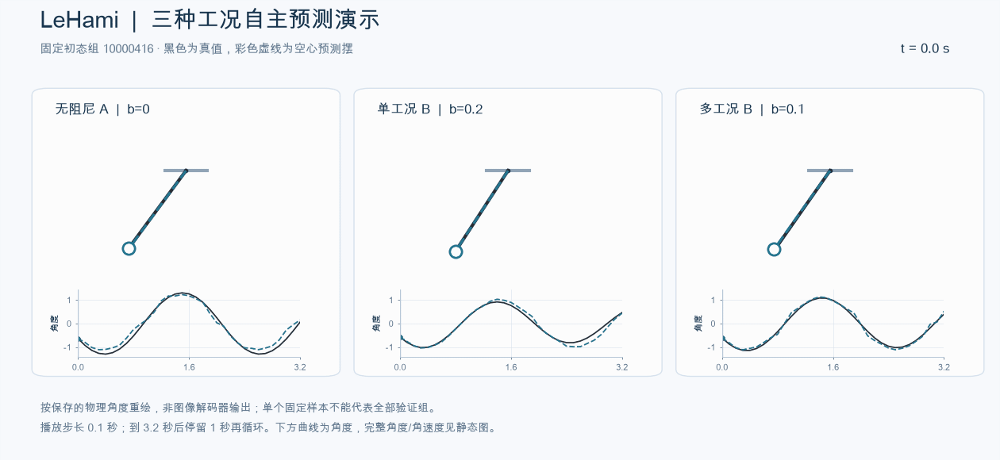
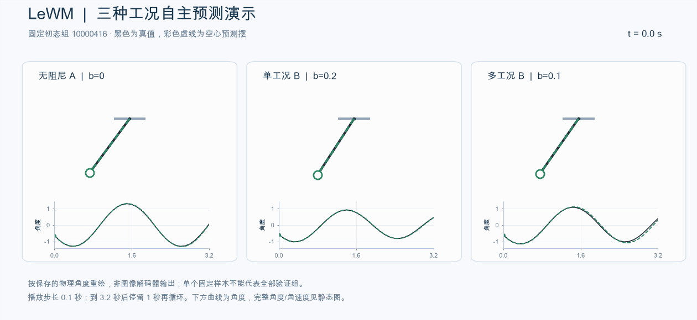
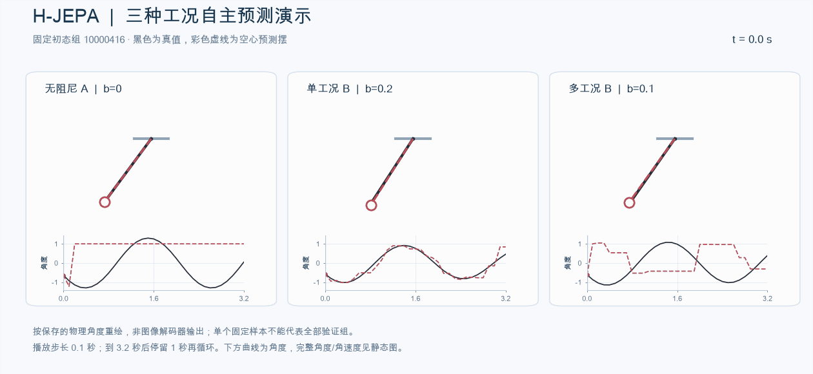

# 结果索引

## 已完成的四方法对比

以下来自冻结的 analysis_summary.json。数值为 **角度MAE（rad）／角速度RMSE（rad/s）**，汇总未来1–32步（0.1–3.2秒），不是只取末帧。单种子、验证集；多阻尼为同64初态组×6工况。

| 方法 | 无阻尼 | 单阻尼 | 多阻尼 |
|---|---:|---:|---:|
| 我们的二维模型 | 0.0687 / 0.2965 | 0.0398 / 0.1855 | 0.0765 / 0.3273 |
| LeHami | 0.1078 / 0.3343 | 0.1070 / 0.5815 | 0.0906 / 0.4847 |
| LeWM | 0.0347 / 0.2115 | 0.0334 / 0.2091 | 0.0973 / 0.5905 |
| H-JEPA | 1.0500 / 3.7294 * | 0.2134 / 1.1491 | 0.6867 / 2.9328 * |

\* H-JEPA无阻尼、多阻尼真实历史读出未通过门槛，其物理误差只能作诊断，不能直接用于算法排名。单阻尼虽通过旧读出门槛，也存在后续发现的冻结。方法的训练方式和计算成本有差异，本表不是等预算优势证明。

[完整 PDF](../experiments/damped_pendulum/output/pdf/four_method_comparison_20261109.pdf) · [含动图 HTML](../experiments/damped_pendulum/reports/method_comparison_20261109/comparison_report.html) · [指标与性能数据](../experiments/damped_pendulum/reports/method_comparison_20261109/analysis_summary.json)

GitHub不会直接执行HTML，下载后用浏览器打开。原报告的停止率存在下述局限，保留原件供追溯。

## 四种方法的演示

同一初态，展示无阻尼、单阻尼和多阻尼模型的一个工况；示例不代表总体表现。

### 我们的二维模型

### LeHami

### LeWM

### H-JEPA

## H-JEPA 诊断与重训

无阻尼预测状态的每步变化量约为真实视频编码变化量的1.1%；92.53%的相邻物理读出完全相同。64/64条轨迹出现真值仍运动而角度连续至少1秒不变。原停止率只检测角速度趋零，漏检“角度静止、读出角速度非零”。这不等于所有工况潜状态完全塌缩，kNN量化也可能产生常值输出。

- [完整轨迹诊断](../experiments/damped_pendulum/reports/hjepa_diagnosis_20261109/trajectory_diagnostics.json)。
- [冻结检查点的表征诊断](../experiments/damped_pendulum/reports/hjepa_diagnosis_20261109/checkpoint_probe.json)。
- [临时移除耗散的推理诊断](../experiments/damped_pendulum/reports/hjepa_diagnosis_20261109/damping_probe.json)。
- [原H-JEPA训练曲线（每250步抽样）](../experiments/damped_pendulum/reports/hjepa_diagnosis_20261109/training_curves)。
- [新分阶段训练方案](../experiments/damped_pendulum/studies/hjepa_staged_retrain_20261109T025341Z/TRAINING_METHOD.txt)。
- [作业提交快照：48085／48086／48087](../experiments/damped_pendulum/studies/hjepa_staged_retrain_20261109T025341Z/submission.json)。

新方案A20k→single/multi各20k，始终保留耗散。提交快照不代表新的训练已经完成。本次没有重新查询服务器。

## 其他结果

- [二维模型分阶段技术报告](../experiments/damped_pendulum/output/pdf/staged_damping_d2_technical_report_20261108.pdf)。
- [维数实验](../experiments/damped_pendulum/studies/dimension_launch_20261105T113319Z/completion_review_20261106.json)。
- [非线性读出实验](../experiments/damped_pendulum/studies/nonlinear_readout_visuals_20261105/assembly_metrics.json)。
- [官方LeHami单种子复现](../experiments/lehami_official_reproduction/reports/results_47141.json)。
- [早期测试技术报告](../experiments/damped_pendulum/output/pdf/dissipative_world_model_test_report_20261105.pdf)。
